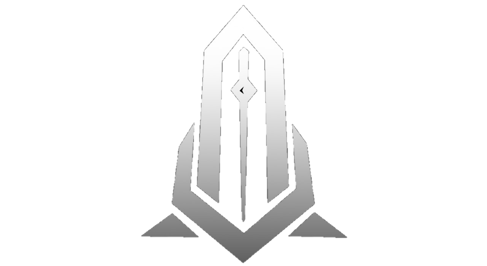

 

# GAMALITH STUDIO

**Independent Game Development Studio**

*We Build Worlds Worth Remembering.*

**Bangladesh 🇧🇩**

---

## About Us

**Gamalith Studio** is an independent game development studio based in Bangladesh, focused on creating engaging, polished, and memorable gaming experiences.

We combine creative ideas, thoughtful game design, and modern development technologies to build games that players enjoy coming back to.

From casual mobile games to interactive multiplayer experiences, our goal is to turn interesting ideas into well-crafted games with strong gameplay foundations and room to grow.

We believe great games are built through creativity, experimentation, attention to detail, and continuous improvement.

## Our Games

We develop and publish games across different genres, with a focus on accessible gameplay, satisfying mechanics, and engaging player experiences.

| Game | Platform | Description | Status |
|---|---|---|---|
| **Arrow Slide** | Android | A satisfying puzzle experience built around arrow-based challenges. | Released |
| **Ball Sorting Puzzle** | Android | Sort colorful balls, solve puzzles, and progress through challenging levels. | Released |
| **Bus Stop Rush** | Android | A time-management game where players manage passengers and bus stop traffic. | Released |

### Play Our Games

- [Arrow Slide – Google Play](https://play.google.com/store/apps/details?id=com.gamalithstudio.arrowslide)
- [Ball Sorting Puzzle – Google Play](https://play.google.com/store/apps/details?id=com.sae.ballsorting)
- [Bus Stop Rush – Google Play](https://play.google.com/store/apps/details?id=com.sae.busstoprush)

Explore more projects on our [official website](https://gamalith.com/games/).

---

## What We Do

We focus on developing complete gaming experiences, from initial concepts to publishing and ongoing updates.

| Area | Description |
|---|---|
| 🎮 **Mobile Game Development** | Designing and developing engaging Android and iOS gaming experiences. |
| 🧩 **Game Design & Prototyping** | Exploring gameplay mechanics, building prototypes, and refining core game loops. |
| 🌐 **Multiplayer Game Development** | Creating real-time multiplayer experiences and networked gameplay systems. |
| 🏗️ **Roblox Game Development** | Building interactive Roblox experiences and gameplay systems. |
| 🎨 **Game Art & UI** | Creating appealing visual styles, intuitive interfaces, and polished player experiences. |
| 📈 **Live Operations** | Improving games through updates, events, analytics, and player feedback. |

## Technology & Tools

We use modern game development technologies and tools to build, optimize, and maintain our projects.

**Game Engines**

**Programming & Development**

**Multiplayer & Backend**

**Art & Design**

## Our Philosophy

We believe game development is more than writing code or creating visuals. It's about building experiences that connect with players.

- **Creativity First** — Every great game starts with an interesting idea.
- **Player-Focused Design** — Gameplay and player experience guide our decisions.
- **Quality Matters** — We continuously refine mechanics, visuals, performance, and usability.
- **Learn & Improve** — We embrace experimentation, feedback, and new technologies.
- **Build for the Long Term** — We aim to create games that can evolve and grow over time.

## Our Development Approach

We follow an iterative development process that allows us to test ideas, identify problems, and improve the experience throughout production.

`Concept` → `Research` → `Prototyping` → `Development` → `Testing` → `Release` → `Live Operations`

## Let's Connect

We're always interested in connecting with fellow developers, publishers, collaborators, and people who share our passion for games.

Whether it's discussing a game concept, exploring publishing opportunities, or collaborating on a new project, we'd love to hear from you.

**Have an idea? Let's build something worth playing.**

 

Made with 💜 in Bangladesh 🇧🇩

© 2026 Gamalith Studio. All rights reserved.

